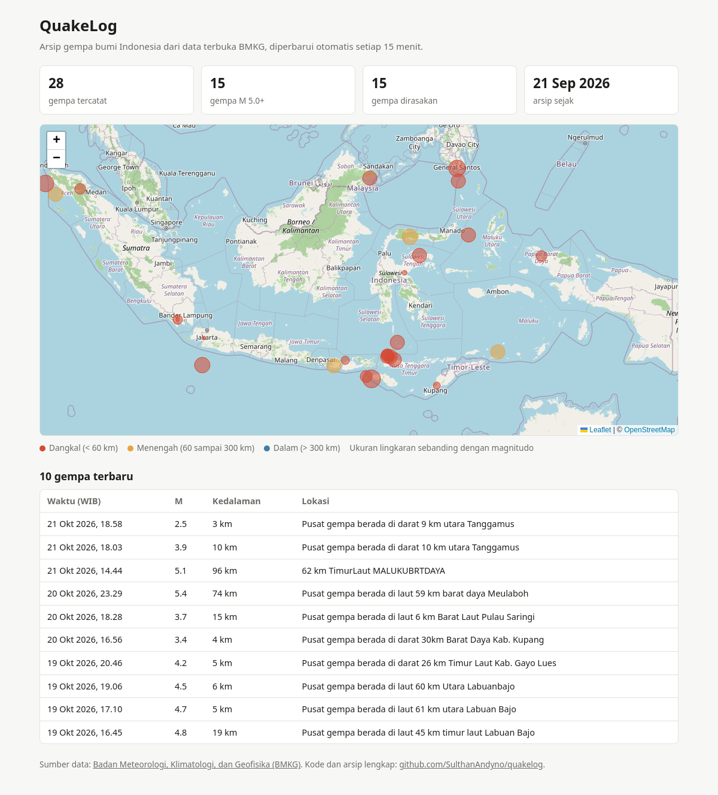

# QuakeLog

[](https://github.com/SulthanAndyno/quakelog/actions/workflows/archive.yml)
[](https://github.com/SulthanAndyno/quakelog/actions/workflows/ci.yml)

Arsip historis gempa bumi Indonesia yang dibangun dari feed data terbuka BMKG. Feed BMKG hanya menampilkan gempa terbaru, 15 gempa M 5.0+ terakhir, dan 15 gempa dirasakan terakhir, sehingga kejadian yang lebih lama hilang dari feed. QuakeLog mengambil ketiga feed tersebut setiap 15 menit, menggabungkan kejadian yang sama dari feed berbeda, lalu menyimpannya ke arsip CSV yang terus bertambah.

Arsip tersedia dalam format CSV ([`data/gempa.csv`](data/gempa.csv)) dan GeoJSON ([`data/gempa.geojson`](data/gempa.geojson)), diperbarui otomatis oleh GitHub Actions, dan divisualisasikan dalam peta interaktif di [sulthanandyno.github.io/quakelog](https://sulthanandyno.github.io/quakelog/).

Arsip mulai dikumpulkan pada 22 Oktober 2026. Eksekusi pertama mencatat 28 kejadian unik dari 31 entri feed (21 September sampai 21 Oktober 2026), karena tiga kejadian muncul di lebih dari satu feed.



## Cara kerja

1. Fetch mengunduh `autogempa.json`, `gempaterkini.json`, dan `gempadirasakan.json` dari BMKG. Salinan mentah setiap feed disimpan di `data/raw/`, sehingga riwayat git menjadi arsip feed asli. Feed yang gagal diambil dicoba ulang tiga kali lalu dilewati; pipeline hanya gagal jika ketiga feed tidak dapat diambil.
2. Transform menyeragamkan format setiap kejadian (waktu UTC, koordinat desimal, magnitudo, kedalaman dalam km).
3. Upsert menggabungkan kejadian ke arsip berdasarkan `event_id`. Kejadian yang muncul di lebih dari satu feed digabung menjadi satu baris, dan nilai kosong dari satu feed tidak menimpa nilai yang sudah ada dari feed lain. Menjalankan pipeline berulang kali pada data yang sama tidak mengubah arsip (idempoten).
4. Cek kualitas dijalankan pada seluruh arsip sebelum disimpan. Jika ada cek yang gagal, arsip tidak ditulis sehingga data lama tetap utuh.
5. Arsip disimpan sebagai CSV dan sebagai GeoJSON FeatureCollection. File GeoJSON dibaca langsung oleh halaman peta di GitHub Pages, sehingga peta ikut diperbarui setiap kali arsip berubah.
6. Workflow melakukan commit ke repositori hanya jika arsip atau feed mentah berubah.

## Skema arsip

Satu baris mewakili satu kejadian gempa.

| Kolom | Deskripsi |
|---|---|
| event_id | Pengenal kejadian dengan format `YYYYMMDDTHHMMSS_lintang_bujur`. BMKG tidak menyediakan ID kejadian, sehingga ID dibentuk dari waktu dan koordinat |
| datetime_utc | Waktu kejadian dalam UTC (ISO 8601) |
| latitude, longitude | Koordinat episentrum dalam derajat desimal, dua angka di belakang koma |
| magnitude | Magnitudo, satu angka di belakang koma |
| depth_km | Kedalaman dalam kilometer |
| wilayah | Deskripsi lokasi dari BMKG. Formatnya berbeda antarfeed, nilai dari feed yang terakhir diproses yang disimpan |
| potensi | Keterangan potensi tsunami atau status dirasakan |
| dirasakan | Daerah yang merasakan beserta skala MMI, hanya untuk gempa dirasakan |
| shakemap | Nama file peta guncangan di `https://static.bmkg.go.id/`, hanya tersedia dari feed gempa terbaru |
| feeds | Feed tempat kejadian pernah muncul, dipisahkan titik koma |
| first_seen_utc | Waktu kejadian pertama kali tercatat oleh QuakeLog |

## Pengecekan kualitas data

- Kolom event_id, datetime_utc, latitude, longitude, magnitude, dan depth_km tidak boleh kosong.
- Waktu kejadian tidak boleh lebih dari satu jam di masa depan.
- Lintang berada di antara -90 dan 90, bujur di antara -180 dan 180.
- Magnitudo berada di antara 0 dan 10.
- Kedalaman tidak boleh negatif.

## Penjadwalan

Workflow `.github/workflows/archive.yml` berjalan setiap 15 menit dan dapat dijalankan manual. Setiap eksekusi menulis ringkasan berisi feed yang berhasil diambil, jumlah kejadian baru, total arsip, dan hasil cek kualitas ke halaman run GitHub Actions. Workflow `ci.yml` menjalankan lint dan test pada setiap perubahan kode.

## Penanganan gangguan

| Gejala | Penyebab umum | Penanganan |
|---|---|---|
| `HTTP Error 403` pada semua feed | Server BMKG menolak User-Agent atau alamat IP | Pastikan header User-Agent di `quakelog/fetch.py` terkirim. Jika hanya terjadi di GitHub Actions, kemungkinan IP runner diblokir dan pipeline perlu dijalankan dari server lain |
| Satu feed gagal, feed lain berhasil | Gangguan sementara di BMKG | Tidak perlu tindakan. Kejadian dari feed tersebut akan terambil pada eksekusi berikutnya selama masih ada di feed |
| `KeyError` saat transform | Struktur JSON BMKG berubah | Bandingkan salinan mentah terbaru di `data/raw/` dengan riwayat git, sesuaikan `quakelog/transform.py`, lalu perbarui test |
| Cek kualitas gagal | Data tidak wajar dari sumber atau bug transform | Periksa event_id yang tercantum di log, tentukan penyebabnya, dan jangan melonggarkan cek hanya agar pipeline lolos |
| Push ditolak | Repositori berubah saat workflow berjalan | Workflow sudah menjalankan `git pull --rebase` sebelum push. Jika tetap gagal, eksekusi berikutnya akan mengulang |

## Batasan

- Arsip dimulai sejak pipeline pertama kali dijalankan. Gempa sebelum itu hanya tercatat jika masih ada di feed saat itu.
- Gempa di bawah M 5.0 yang tidak dirasakan hanya muncul di feed gempa terbaru. Jika terjadi lebih dari satu gempa seperti ini dalam selang 15 menit, hanya yang terakhir yang tercatat.
- Jadwal GitHub Actions dapat tertunda beberapa menit saat beban tinggi.
- Jika BMKG merevisi waktu atau koordinat sebuah kejadian, revisi tersebut tercatat sebagai kejadian baru karena event_id berubah.

## Menjalankan

Membutuhkan Python 3.12 dan [uv](https://docs.astral.sh/uv/). Pipeline hanya memakai pustaka standar Python.

```bash
uv sync
uv run python -m quakelog   # satu siklus pengarsipan
uv run pytest -q            # menjalankan test
```

## Struktur repositori

```
quakelog/
  fetch.py        unduh feed BMKG dan simpan salinan mentah
  transform.py    penyeragaman format dan penggabungan kejadian
  store.py        baca dan tulis arsip CSV
  quality.py      pengecekan kualitas data
  __main__.py     menjalankan satu siklus
data/
  gempa.csv       arsip kejadian gempa
  gempa.geojson   arsip dalam format GeoJSON untuk peta
  raw/            salinan mentah feed terakhir
tests/            test dengan data contoh
.github/workflows CI dan pengarsipan terjadwal
index.html        halaman peta (GitHub Pages)
docs/peta.png     tangkapan layar peta
```

## Sumber data

Data gempa bumi bersumber dari Badan Meteorologi, Klimatologi, dan Geofisika (BMKG) melalui [Data Terbuka BMKG](https://data.bmkg.go.id/gempabumi/). Sesuai ketentuan portal tersebut, BMKG wajib dicantumkan sebagai sumber data dan akses dibatasi 60 permintaan per menit per IP. QuakeLog mengakses tiga feed setiap 15 menit, jauh di bawah batas tersebut.

Peta dasar pada halaman peta menggunakan [OpenStreetMap](https://www.openstreetmap.org/copyright) dan ditampilkan dengan [Leaflet](https://leafletjs.com/).
